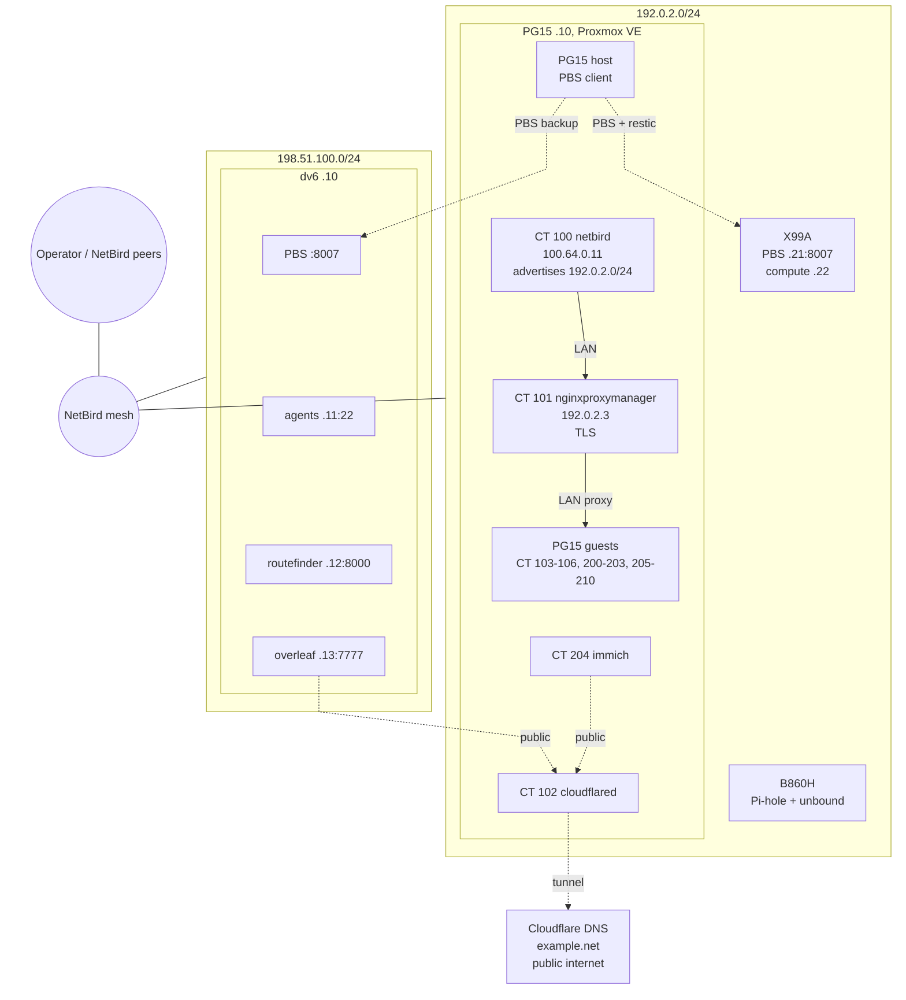

# homelab

Four machines run this lab: PG15, X99A, the B860H and dv6 with its Incus guests. Personal
devices and unrelated NetBird peers are left out. The inventories in [`docs/`](docs/) go
machine by machine, then cover how the network fits together.

The hardware, guests and ports below come from root audits of PG15, X99A and dv6 on
2026-11-10.

## Topology

## Machines

| Machine | LAN | NetBird | OS | Role |
| --- | --- | --- | --- | --- |
| `PG15` | `192.0.2.10` | none (CT 100 is the peer) | Debian 13, Proxmox VE | 17 LXC containers and one VM |
| `X99A` | `192.0.2.20` | `100.64.0.13` | Arch Linux, Incus | Bulk storage, LAN-side PBS, compute |
| `B860H` | `192.0.2.30` | `100.64.0.12` | Armbian, ZTE ZXV10 B860H v2 | Pi-hole and unbound |
| `dv6` | `198.51.100.10` | `100.64.1.11` | Debian 13, Incus | Offsite PBS, Syncthing, authoring container |

## Hardware

| Machine | CPU | RAM | Storage |
| --- | --- | --- | --- |
| `PG15` | Intel Core i5-9300H, 4C/8T | 16 GB | 1 TB HDD, 512 GB NVMe |
| `X99A` | Intel Xeon E5-2696v4, 22C/44T | 64 GB | 512 GB NVMe, 240 GB SATA SSD, 1 TB HDD, 320 GB HDD, 3× 500 GB HDD |
| `B860H` | Amlogic S905X, 4× A53 | 2 GB | 8 GB eMMC |
| `dv6` | Intel Core i7-2720QM, 4C/8T | 16 GB | 120 GB SSD, 1 TB HDD |

All disks report SMART PASSED.

## What runs where

Private service traffic stays on the NetBird mesh. Only `overleaf` and `immich` are
published through the Cloudflare tunnel.

### PG15

| VMID | Guest | Role | Ports | State |
| --- | --- | --- | --- | --- |
| 100 | `netbird` | NetBird peer and SSH jump host | 53, 51820/udp | running |
| 101 | `nginxproxymanager` | TLS termination and reverse proxy | 80, 443, 81 | running |
| 102 | `cloudflared` | Cloudflare Tunnel connector | none | running |
| 103 | `syncthing` | File sync | 8384, 22000, 21027/udp | running |
| 104 | `sftpgo` | SFTP and WebDAV | 2022, 8080, 8090 | running |
| 105 | `baikal` | CalDAV and CardDAV | 80 | running |
| 106 | `ntfy` | Push notifications | 80 | running |
| 200 | `haos` | Home Assistant OS VM | 8123, 4357, 18555 | running |
| 201 | `agents` | Former authoring container | 22 | stopped |
| 202 | `llama-server` | llama.cpp embedding server | 10802 | running |
| 203 | `navidrome` | Music streaming | 4533, 7288 | running |
| 204 | `immich` | Photo and video library; public via Cloudflare tunnel | 2283, 3003 | running |
| 205 | `overleaf` | Former Overleaf container | none | stopped |
| 206 | `convertx` | File format conversion | 3000 | running |
| 207 | `docker-gpu` | Immich ML, SnapOtter | 1349, 3003 | running |
| 208 | `suwayomi` | Manga reader | 4567 | running |
| 209 | `searxng` | Metasearch | 8888 | running |
| 210 | `trilium` | Notes | 8080 | running |

SSH on 22 and loopback-only database, metrics and discovery sockets are left out, except on
the `agents` containers, which are SSH-heavy.

[`docs/architecture.md`](docs/architecture.md) has the full inventory: tags, bind mounts and
storage.

### X99A

| Guest | Address | Ports | Role |
| --- | --- | --- | --- |
| `proxmox-backup-server` (`x99a-pbs`) | `192.0.2.21` | 8007 | PBS, datastore `pg15` |
| `agents` (`compute`) | `192.0.2.22` | 22 | 20 cores, 24 GB, RX 6700 XT; `ssh compute` |

Strata serves Qwen3.6 on `:8080`, and restic writes to `/mnt/pool/restic-backups` on X99A
from both PG15 and dv6. The Immich ML container is stopped. Bulk storage is mergerfs
`/mnt/pool` over `/mnt/static`, `/mnt/scratch1` and `/mnt/scratch2`, with `/mnt/parity` as
SnapRAID parity.

Details: [`docs/machines.md`](docs/machines.md).

### dv6

| Guest | Address | Ports | Role |
| --- | --- | --- | --- |
| `agents` (`agents-dv6`) | `198.51.100.11` | 22 | Authoring container and this checkout |
| `routefinder` | `198.51.100.12` | 8000 | Route search; inbound-only |
| `overleaf` | `198.51.100.13` | 7777 | Overleaf; public via Cloudflare tunnel |

The host also runs Proxmox Backup Server on `:8007` (datastore `pg15`), Syncthing, Pi-hole
and unbound. Details: [`docs/machines.md`](docs/machines.md).

### B860H

Pi-hole v6 and unbound, using the same configuration as dv6: unbound on
`127.0.0.1:5335` over DoT, private domain `example.net`. The public `example.net` zone is at
Cloudflare, and NPM issues its certificates with the Cloudflare DNS challenge.

## How the machines connect

| From | To | Path | Purpose |
| --- | --- | --- | --- |
| PG15 | `x99a-pbs` `:8007` | LAN `192.0.2.0/24` | Backup target `x99a-pbs` |
| PG15 | dv6 `:8007` | NetBird tunnel to `100.64.1.11` | Backup target `dv6-pbs` |
| `agents-dv6` | PG15 `:8006` | NetBird, route `192.0.2.0/24 dev wt0 table 7120` | Management API |
| `agents-dv6` | dv6 | LAN `198.51.100.0/24`, or NetBird `100.64.1.11` | Host access, PBS |
| Operator | Any lab host | `ssh <target>` over NetBird | Direct mesh access |
| Any lab host | `*.example.net` | CT 101 proxy | Published services |

| Peer | NetBird IP | Advertises |
| --- | --- | --- |
| `pg15` (CT 100) | `100.64.0.11` | `192.0.2.0/24` |
| `b860h` | `100.64.0.12` | none |
| `x99a` | `100.64.0.13` | none |
| `dv6` | `100.64.1.11` | `198.51.100.0/24` |

CT 100 is the only router between the overlay and the lab LAN. It advertises
`192.0.2.0/24` and masquerades mesh traffic, so a LAN host sees `192.0.2.2`. dv6 advertises
its own LAN, so a mesh peer reaches the Incus guests directly. The B860H and X99A advertise
nothing and are reached through CT 100.

## Documentation

| Document | Contents |
| --- | --- |
| [`docs/architecture.md`](docs/architecture.md) | The `PG15` node: topology, every guest, bind mounts, storage. |
| [`docs/machines.md`](docs/machines.md) | X99A, the B860H and dv6: what they are, what they run, what they back up. |
| [`docs/network.md`](docs/network.md) | Subnets, the mesh, the interfaces that carry routes, DNS, TLS, firewall. |
| [`configs/verbatim/`](configs/verbatim/) | Verbatim interfaces and units from the hosts. |
