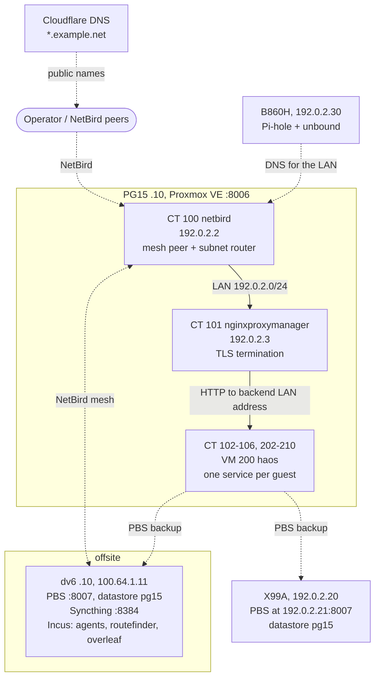

# `PG15`, the Proxmox node

One Proxmox node: 17 LXC containers and a single QEMU VM on a desktop CPU in a tower case.
CT 201 `agents` and CT 205 `overleaf` are stopped on purpose. Both moved to Incus guests on
dv6, and their configuration stays so either can be started again. The rest of the lab is
in [machines.md](machines.md); the network they share is in [network.md](network.md).

## Host

| Item | Value |
|---|---|
| Node name | `PG15` |
| Proxmox VE | `pve-manager/9.2.21` |
| Kernel | `7.0.14-24-pve` |
| CPU | Intel Core i5-9300H, 4 cores / 8 threads |
| RAM | 16 GB, 8 GB swap |
| Disks | 512 GB PCIe SSD for `local` and `local-lvm`; 1 TB HDD for `local-hdd` |
| Bridge | `vmbr0` = `192.0.2.10/24`, gateway `192.0.2.1`, port `nic0`, STP off |
| Spare NICs | `nic1` and `wlo1` are present but inactive |
| Web UI and API | `https://192.0.2.10:8006/` |
| SDN | none, so every guest attaches to the plain Linux bridge |

## Topology

## Traffic paths

Operator access goes over the NetBird mesh and lands on CT 100. The Cloudflare path exists
for `overleaf` and `immich` and nothing else.

A proxied request arrives at Cloudflare, travels down the tunnel to CT 102, and lands on
CT 101 NPM, which terminates TLS and forwards to the backend over plain HTTP on its LAN
address. Everything else stays on the mesh.

Backups go from every guest to two Proxmox Backup Server datastores, both on `:8007`:
`x99a-pbs` on the LAN and `dv6-pbs` over the mesh. Both keep all backups
(`keep-all=1`), so retention is a matter of disk rather than policy.

## Guests

All containers share one shape: unprivileged, `nesting` and `keyctl` on, Debian, rootfs on
`local-lvm`, one `net0` on `vmbr0` with a static IPv4, no VLAN tag and no MTU override.
`haos` is the only VM.

| VMID | Hostname | Kind | Address | Resources | What it does |
|---|---|---|---|---|---|
| 100 | `netbird` | LXC | `192.0.2.2` | 1c / 128M / 4G | Mesh peer and subnet router; the only route between mesh and LAN |
| 101 | `nginxproxymanager` | LXC | `192.0.2.3` | 2c / 256M / 8G | TLS termination and proxy hosts for `*.example.net` |
| 102 | `cloudflared` | LXC | `192.0.2.4` | 1c / 128M / 2G | Cloudflare Tunnel connector, outbound only |
| 103 | `syncthing` | LXC | `192.0.2.5` | 2c / 256M / 8G | File sync; data in `/mnt/hdd/syncthing` |
| 104 | `sftpgo` | LXC | `192.0.2.6` | 2c / 128M / 4G | SFTP and WebDAV file server |
| 105 | `baikal` | LXC | `192.0.2.7` | 1c / 128M / 4G | CalDAV and CardDAV |
| 106 | `ntfy` | LXC | `192.0.2.8` | 1c / 128M / 2G | Push notifications; the alert sink for SMART and SnapRAID |
| 200 | `haos` | VM | guest-controlled | 2c / 4096M / 32G | Home Assistant OS: QEMU agent, EFI disk, `serial0` socket |
| 201 | `agents` | LXC | `192.0.2.100` | 6c / 6144M / 40G | Stopped. Authoring container, moved to dv6 |
| 202 | `llama-server` | LXC | `192.0.2.101` | 4c / 1024M / 16G | llama.cpp embedding server on `:10802` |
| 203 | `navidrome` | LXC | `192.0.2.102` | 2c / 256M / 8G | Music streaming; library is the Syncthing share |
| 204 | `immich` | LXC | `192.0.2.103` | 4c / 6144M / 32G | Photo library with NVIDIA devices passed through; PostgreSQL and Redis local |
| 205 | `overleaf` | LXC | `192.0.2.104` | 2c / 2048M / 32G | Stopped. Overleaf now runs on dv6 |
| 206 | `convertx` | LXC | `192.0.2.105` | 2c / 512M / 12G | File format conversion |
| 207 | `docker-gpu` | LXC | `192.0.2.106` | 6c / 6144M / 64G | Docker stack: Immich ML `:3003`, SnapOtter `:1349`, NVIDIA devices |
| 208 | `suwayomi` | LXC | `192.0.2.107` | 2c / 1024M / 12G | Manga reader; library in `/mnt/hdd/suwayomi` |
| 209 | `searxng` | LXC | `192.0.2.108` | 2c / 128M / 8G | Metasearch |
| 210 | `trilium` | LXC | `192.0.2.109` | 1c / 512M / 4G | Notes |

## Bind mounts

Every `mp*` is a host path bind-mounted into a container, and every host path lives on
`local-hdd`. A backup of the container volume does not carry any of it, so a container
restored without its mounts comes back with empty data and the wrong paths.

| Guest | Host path under `/mnt/hdd` | Container path |
|---|---|---|
| 103 `syncthing` | `syncthing` | `/mnt/hdd/syncthing` |
| 104 `sftpgo` | `sftpgo` | `/mnt/hdd/sftpgo` |
| 201 `agents` | `hermes-agent` | `/mnt/hdd/hermes-agent` |
| 201 `agents` | `sftpgo/agents` | `/mnt/hdd/sftpgo/agents` |
| 201 `agents` | `syncthing/Documents` | `/mnt/hdd/syncthing/Documents` |
| 201 `agents` | `Documents` | `/mnt/hdd/Documents` |
| 203 `navidrome` | `syncthing/Music` | `/mnt/hdd/syncthing/Music` |
| 204 `immich` | `immich/immich-lxc` | `/mnt/hdd/immich` |
| 204 `immich` | `immich/external-libraries` | `/mnt/hdd/external-libraries` |
| 204 `immich` | `syncthing/WhatsApp/Media/WhatsApp Images` | `/mnt/hdd/external-libraries/whatsapp/WhatsApp Images` |
| 204 `immich` | `syncthing/WhatsApp/Media/WhatsApp Video` | `/mnt/hdd/external-libraries/whatsapp/WhatsApp Video` |
| 208 `suwayomi` | `suwayomi` | `/mnt/hdd/suwayomi` |

## Storage

| Storage ID | Type | Backing | Content | Free / total at capture |
|---|---|---|---|---|
| `local` | `dir` | `/var/lib/vz` on the root filesystem | templates, ISOs, backups | 78G / 100G |
| `local-lvm` | `lvmthin` | VG `pve`, thinpool `data` | container and VM rootfs | 132G / 350G |
| `local-hdd` | `dir` | `/mnt/hdd`, the 1 TB HDD | bind-mount sources | 623G / 1 TB |
| `x99a-pbs` | `pbs` | PBS at `192.0.2.21`, datastore `pg15` | backups | 173G / 313G |
| `dv6-pbs` | `pbs` | PBS at `100.64.1.11`, datastore `pg15` | backups | 403G / 1 TB |

Both PBS storages are marked shared, use `root@pam`, and pin a certificate fingerprint.
Free space was captured on 2026-11-07.

## Notifications

Alerts do not go through Proxmox. They go to `ntfy` in CT 106, which CT 101 publishes as
`ntfy.example.net` and forwards to `192.0.2.8:80`.

| Source | Host | Trigger | Topic |
|---|---|---|---|
| `smartd` | PG15 | SMART warning or failure | `smartd-pg15` |
| `smartd` | X99A | SMART warning or failure | `smartd-x99a` |
| `smartd` | dv6 | SMART warning or failure | `smartd-dv6` |
| SnapRAID script | X99A | `snapraid-aio.timer`, daily 04:00 | `snapraid-x99a` |

Each host reports to its own SMART topic, so an empty topic means no disk has crossed a
threshold rather than a hook that stopped firing. The SnapRAID script posts a start
message and a completion message per run.

The server runs with `enable_login=false` and `require_login=false`. The topic name is the
only thing standing between a stranger on the network and the messages, and they expire
after twelve hours. `GET /<topic>/json` returns one JSON object per line.
